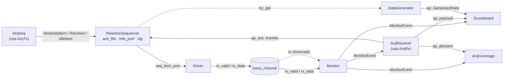

# Módulo 9: Estímulo reactivo

**Objetivo**: construir un testbench en el que lo que se observa en el DUT
decide lo que se envía a continuación, y usarlo como banco de pruebas para las
capacidades de UVM que los módulos anteriores solo enseñan por separado.

Hasta aquí todas las secuencias del curso son de lazo abierto: generan
transacciones sin mirar qué respondió el DUT. Muchos protocolos reales no se
pueden estimular así: handshakes con reintentos, control de flujo, esclavos que
responden a peticiones, retransmisión ante pérdidas. Este módulo cubre ese caso
con un ejemplo completo: un **ARQ de repetición selectiva** sobre un canal con
pérdidas.

Código: [`module9/`](../module9/). Para ejecutarlo:

```bash
cd module9/tests/pyuvm_tests
uv run make            # los tres tests
uv run make WAVES=1    # con lossy_channel.vcd
```

## 1. El DUT y el dato

`module9/dut/channel/lossy_channel.vhd`: lo que entra por TX sale por RX un
ciclo después, salvo que el canal lo descarte. Las pérdidas las decide un LFSR
de 8 bits (se pierde cuando sus dos bits bajos valen `00`, un 25 %), así que son
deterministas. El puerto `lfsr_seed` se carga en el LFSR durante el reset y
elige el patrón de pérdidas; con semilla 0 el canal lo pierde todo.

El canal no interpreta el dato. El formato solo lo conoce el testbench
(`defs.py`):

| Bits | Campo | Uso |
|---|---|---|
| 7..4 | `seq` | Numeración, de 0 a 15 con vuelta a 0 |
| 3..0 | `info` | Información. `0` está reservado como relleno (`NO_DATA`) |

## 2. Arquitectura



El lazo reactivo es `Monitor → ArqReceiver → ack_fifo (en el sequencer) →
ArqSeq → Driver → DUT → Monitor`.

| Archivo | Contenido |
|---|---|
| `defs.py` | Formato del dato: `pack`, `unpack`, `SEQ_MOD`, `NO_DATA` |
| `config.py` | `ArqConfig` (ventana, timeout, nº de datos, semilla del canal) y `get_cfg()` |
| `items.py` | Eventos de análisis y los tres sequence items |
| `channel_model.py` | `LossyChannelModel`: modelo de referencia del DUT, Python puro |
| `arq_tx.py`, `arq_rx.py` | Las dos mitades del ARQ, Python puro, sin UVM |
| `arq_receiver.py` | `ArqReceiver`: envuelve `ArqRx` en un `uvm_subscriber` |
| `generator.py` | `DataGenerator` y `AlwaysReadyGenerator` (para override) |
| `reactive_sequencer.py` | Sequencer con `ack_fifo`, `info_port` y `cfg` |
| `arq_sequence.py` | `ArqSeq`: la secuencia reactiva |
| `driver.py`, `monitor.py`, `agent.py` | Agente |
| `scoreboard.py` | Tres comprobaciones independientes |
| `arq_coverage.py` | `ArqCoverage`: 13 bins de cobertura funcional |
| `env.py`, `test_reactive_arq.py` | Entorno y tests |

## 3. Las ideas que hay que llevarse

### 3.1 Una secuencia no tiene puertos: todo le llega por el sequencer

Una secuencia es un `uvm_object`, no un componente. No tiene `build_phase` ni
puede conectar nada. Lo que necesita del entorno lo alcanza por
`self.sequencer`, que sí es un componente:

```python
class ReactiveSequencer(uvm_sequencer):
    def build_phase(self):
        self.cfg = get_cfg(self)
        self.ack_fifo = uvm_tlm_analysis_fifo("ack_fifo", self)        # lo observado
        self.info_port = uvm_nonblocking_get_port("info_port", self)   # qué enviar
```

Es la misma idea que el sequencer virtual del módulo 5, usada para datos en vez
de para otros sequencers.

### 3.2 Tres formas de que la secuencia sepa qué pasó

| Mecanismo | Cómo | Cuándo |
|---|---|---|
| Campo del propio item | el driver escribe en el item; la secuencia lo lee tras `finish_item()` | la respuesta llega en la misma transacción |
| `put_response()` / `get_response()` | el driver devuelve un item de respuesta | petición y respuesta emparejadas, una a una |
| FIFO de análisis en el sequencer | un monitor publica; la secuencia hace `try_get()` | la respuesta llega más tarde, puede no llegar o llegar sin haberla pedido |

Aquí solo sirve la tercera: una confirmación puede no llegar nunca (el canal
perdió el dato) y eso no puede bloquear a la secuencia. Por eso se lee con
`try_get()`. Un `get()` bloqueante se colgaría exactamente en el caso que el ARQ
existe para resolver.

### 3.3 El tiempo se mide, no se cuenta

La secuencia decide retransmitir por tiempo. Ese tiempo sale del simulador
(`get_sim_time`), no de contar items, y el timeout de cada dato empieza cuando
`finish_item()` vuelve, es decir, cuando el driver terminó de enviarlo. Contar
items solo funciona mientras cada item dure un ciclo exacto y el driver no tarde
en arrancar (el reset ya rompe esa suposición).

### 3.4 El monitor muestrea en el flanco de bajada

El driver escribe justo después del flanco de subida. Si el monitor leyera en
ese mismo flanco, qué ve dependería del orden en que el simulador despierta las
corrutinas. A mitad de ciclo no hay ambigüedad: las entradas tienen lo que el
DUT va a capturar en el siguiente flanco de subida y las salidas, el resultado
del anterior. De paso, la confirmación llega al sequencer medio ciclo antes de
que la secuencia decida, siempre.

Cronología de un dato enviado en el ciclo `k`:

| Momento | Qué ocurre |
|---|---|
| subida `k` | la secuencia decide; el driver pone `tx_valid` |
| bajada `k` | el monitor ve el TX |
| subida `k+1` | el DUT captura; `finish_item()` vuelve; empieza el timeout |
| bajada `k+1` | el monitor ve el RX; `ArqReceiver` escribe el ACK |
| subida `k+2` | la secuencia lee el ACK (un ciclo después de terminar el envío) |

De aquí sale que `timeout = 1` es el mínimo que no retransmite de más y que
`timeout = 0` retransmite siempre antes de que pueda llegar la confirmación.

### 3.5 Varios tipos de item en un mismo driver

En pyuvm el `seq_item_port` no está tipado. El driver despacha con `match`, y
un tipo desconocido es un error, no un caso ignorado:

```python
match item:
    case NewDataItem() | RetxItem():
        await self.drive(pack(item.seq, item.info))
    case IdleItem():
        await self.idle(item.cycles)
    case _:
        raise TypeError(f"Item desconocido: {type(item).__name__}")
```

El driver solo hace protocolo. Qué información se envía lo decide la secuencia
(la pide al generador); así un test puede cambiar el estímulo sin tocar el driver.

### 3.6 El scoreboard comprueba el DUT y el testbench por separado

El ARQ vive entero en el testbench. Un scoreboard que solo comparase "lo
generado contra lo entregado" estaría comprobando el testbench contra sí mismo y
el canal podría hacer casi cualquier cosa. Por eso hay tres comprobaciones:

| | Qué comprueba | Referencia |
|---|---|---|
| A | El canal: cada RX es el dato del modelo, un ciclo después, con las mismas pérdidas | `LossyChannelModel` |
| B | El bus TX: numeración consecutiva, la información es la generada, una retransmisión repite el original | deducida del bus, sin usar `ArqTx` |
| C | Extremo a extremo: lo liberado es lo generado, una vez y en orden | lo que entregó el generador |

Las tres se hacen sobre la marcha: el error aparece en el log en el ciclo en que
ocurre, y `check_phase` solo cierra las cuentas.

### 3.7 Verde no significa probado

Con la configuración por defecto la ida y vuelta de la confirmación es más corta
que el timeout y las confirmaciones nunca se pierden, así que **el receptor
nunca recibe un duplicado**: esa rama de `ArqRx` no se ejecuta. `ArqCoverage` lo
hace visible; al final de cada test lista los bins sin cubrir. `TestArqImpatient`
existe para cubrir ese bin, y a cambio deja sin cubrir los de recepción
adelantada. Ningún test los cubre todos: es la razón de ser de una regresión.

## 4. Los tests

Los tres usan el mismo entorno; solo cambian `configure()` u `overrides()`.

| Test | Qué cambia | Mecanismo UVM |
|---|---|---|
| `TestArqDefault` | nada | — |
| `TestArqImpatient` | `cfg.timeout = 0` | objeto de configuración por ConfigDB |
| `TestArqNoFiller` | `DataGenerator` → `AlwaysReadyGenerator` | override de tipo en la factory |

La semilla del canal (`cfg.lfsr_seed`) sale del `random` que cocotb siembra, así
que cada ejecución usa otro patrón de pérdidas y `RANDOM_SEED=<n>` lo reproduce.

## 5. Ejercicios

Cada ejercicio dice qué capacidad de UVM entrena y cuándo está hecho. No hay
soluciones en el repositorio.

### Bloque A: reactividad

**A1. Cerrar la cobertura.** Escribe los tests que hagan falta para que, entre
todos, los 13 bins queden cubiertos. *Hecho cuando*: sabes decir qué test cubre
cada bin y por qué `TestArqImpatient` no puede cubrir `buffer_3`.

**A2. Respuestas con `put_response`.** Haz que el driver devuelva una respuesta
con el ciclo en que puso el dato en el bus y que la secuencia use ese valor en
lugar de `get_sim_time`. *Hecho cuando*: los tres tests siguen en verde y puedes
explicar por qué las confirmaciones no se pueden pasar por `get_response`.

**A3. Reset en caliente.** Añade un test que active `rst` en mitad del tráfico.
El monitor ya publica `Source.RESET` y el scoreboard reinicia su modelo, pero el
receptor y la secuencia lo ignoran. pyuvm no tiene saltos de fase: diseña cómo
se entera cada uno. *Hecho cuando*: tras el reset el ARQ se resincroniza y todo
lo generado después se entrega.

**A4. Go-back-N.** Escribe `GoBackNSeq`, que ante un timeout reenvía todo desde
el dato perdido, y sustitúyela por la factory. *Hecho cuando*: el mismo
scoreboard la acepta sin cambios y la cobertura muestra la diferencia de
retransmisiones con la repetición selectiva.

### Bloque B: factory

**B1. Inyección de errores por override.** Crea `CorruptingDriver(Driver)`, que
cambia un bit de la información en una de cada N retransmisiones, e instálalo
con un override. *Hecho cuando*: el test falla por la comprobación B ("RETX ...
el original era ...") y lo marcas como fallo esperado con
`@pyuvm.test(expect_fail=True)`.

**B2. Override por instancia.** Con dos agentes (ver D2), sustituye el driver de
uno solo con `set_inst_override_by_type`. *Hecho cuando*: el log muestra que
solo un extremo inyecta errores.

### Bloque C: configuración

**C1. Barrido de configuración.** Genera tests para ventanas 1, 2, 4 y 8 y
timeouts 1, 2 y 8 sin copiar la clase doce veces. *Hecho cuando*: `ventana = 9`
se rechaza en `build_phase` con el mensaje de `validate()`.

**C2. Agente pasivo.** Añade `is_active` a la configuración del agente. En modo
pasivo solo crea monitor y receptor. *Hecho cuando*: un entorno con un agente
activo y otro pasivo escuchando el mismo canal entrega lo mismo por los dos.

### Bloque D: secuencias

**D1. Capas de secuencias.** Sustituye `DataGenerator` por una secuencia de
nivel superior (`PayloadSeq`) que corre en su propio sequencer y solo sabe de
información. `ArqSeq` pasa a ser la capa de traducción: toma items de arriba y
les pone numeración y retransmisión. *Hecho cuando*: se puede cambiar el
contenido (ráfagas, patrones, todo ceros salvo el relleno) arrancando otra
secuencia de carga, sin tocar el ARQ.

**D2. Enlace bidireccional con secuencia virtual.** Instancia dos canales (un
`duplex_channel.vhd` con dos `lossy_channel`), un agente por sentido, y haz que
las confirmaciones viajen por el canal de vuelta y también se pierdan. Una
secuencia virtual coordina los dos extremos. *Hecho cuando*: aparecen
retransmisiones provocadas por la pérdida de un ACK, no del dato, y hay un bin
de cobertura que lo demuestra.

**D3. Biblioteca de escenarios.** Secuencias pequeñas (ráfaga, silencio largo
con `IdleItem(cycles=n)`, llenar la ventana) y una secuencia padre que las elige
al azar. *Hecho cuando*: un `IdleItem(cycles=8)` no provoca ninguna
retransmisión espuria.

### Bloque E: fases y fin de test

**E1. Fin de test sin números mágicos.** El test espera 3 ciclos fijos antes de
bajar la objeción. Haz que el scoreboard mantenga una objeción mientras tenga
datos pendientes de ver en RX. *Hecho cuando*: el margen fijo desaparece y un
canal con latencia 5 (ver F1) no rompe el fin de test.

**E2. Cada cosa en su fase.** Reparte el final entre `extract_phase` (recoger
contadores), `check_phase` (decidir) y `report_phase` (imprimir), y usa
`final_phase` para escribir un resumen en JSON. *Hecho cuando*: dos ejecuciones
con el mismo `RANDOM_SEED` producen el mismo JSON.

### Bloque F: verificar el verificador

**F1. Mutaciones del DUT.** Rompe `lossy_channel.vhd` de una forma cada vez y
anota qué comprobación lo detecta:

| Mutación | ¿La detecta A? | ¿B? | ¿C? |
|---|---|---|---|
| latencia de 2 ciclos | | | |
| `drop` con `lfsr(2 downto 0) = "000"` | | | |
| un bit de `rx_data` invertido | | | |
| `rx_valid` dura dos ciclos | | | |
| el LFSR no se recarga en reset | | | |

*Hecho cuando*: la tabla está completa. Si alguna mutación pasa en verde, falta
una comprobación.

**F2. Mutaciones del testbench.** Lo mismo con el ARQ: que `ArqRx` libere fuera
de orden, que `ArqTx` no avance `base`, que el monitor muestree en el flanco de
subida. *Hecho cuando*: sabes cuáles detecta el scoreboard y cuáles solo se ven
en la cobertura.

### Bloque G: lo que pyuvm no trae

pyuvm 4.0.1 no implementa `lock`/`grab` ni prioridades en el sequencer,
`uvm_callbacks`, `uvm_event`, drain time ni `phase_ready_to_end`. Construirlos
a mano enseña para qué sirven.

**G1. Callbacks en el driver.** Con el mecanismo de callbacks del módulo 5,
añade un gancho `pre_drive(item)` que pueda modificar o descartar el item.
Reescribe B1 con un callback en lugar de un override. *Hecho cuando*: sabes
decir cuándo conviene cada uno.

**G2. Prioridad de retransmisión.** Separa el ARQ en dos secuencias sobre el
mismo sequencer: una que envía datos nuevos y otra que retransmite. Sin
prioridades en pyuvm, la de datos puede dejar sin turno a la otra. Implementa el
arbitraje. *Hecho cuando*: con la ventana llena, la retransmisión sale siempre
antes que un dato nuevo.

### Proyecto final: el ARQ dentro del DUT

Mueve la mitad transmisora del ARQ a VHDL, con ventana y timeout en registros
de configuración accesibles por un bus sencillo. El testbench pasa a ser solo el
extremo remoto: canal, receptor y confirmaciones. Usa el modelo de registros de
pyuvm (`uvm_reg`, adaptador y predictor) para configurarlo, y `ArqTx` como
modelo de referencia en el scoreboard.

*Hecho cuando*: el agente reactivo verifica hardware de verdad, y las mutaciones
de F2 aplicadas al VHDL las detecta el scoreboard.
